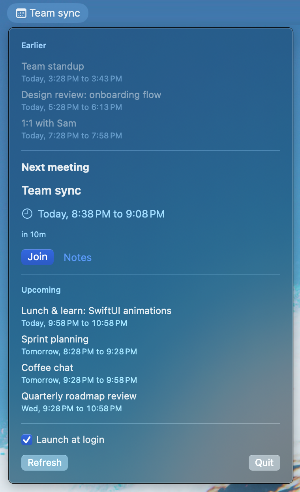

# NextMeetingBar

A tiny native macOS menu bar app that shows your next upcoming meeting and notifies you before it starts. Built with SwiftUI + EventKit — it reads whatever calendars macOS already syncs (including Google Calendar added via System Settings), so there's no OAuth, API keys, or sync logic of its own.

<p align="center"></p>

## Features

- **Compact menu bar label** — shows the next meeting's title, adapting to your display: full title on a wide/external display, truncated to 10 characters on the built-in screen.
- **Popover panel** — today's earlier meetings, the next meeting with a countdown ("in 3h 19m") plus Join and Notes links scraped from the event, and an Upcoming list for the rest of the week.
- **Notifications** — fires ~5 minutes before a meeting starts.
- **Launch at login** — toggle in the panel (via `SMAppService`).
- **Menu-bar-only** — no Dock icon (`LSUIElement`).

## Requirements

- macOS 14+
- Swift 6 toolchain (Xcode command line tools)

## Build & run

```sh
./build.sh          # compiles, assembles NextMeetingBar.app, code-signs it
open NextMeetingBar.app
```

On first launch, grant calendar access when prompted (or enable it under
System Settings → Privacy & Security → Calendars).

### Stable signing (optional but recommended)

By default the build falls back to **ad-hoc** signing, which makes macOS re-prompt
for calendar access on every rebuild. To make the grant persist, create a one-time
self-signed code-signing certificate and the build will use it automatically:

1. Keychain Access → Certificate Assistant → **Create a Certificate…**
2. Name: `NextMeetingBar Dev`, Identity Type: **Self-Signed Root**, Type: **Code Signing**

## Project layout

```
Package.swift              # SwiftPM executable target (macOS 14+)
Info.plist                 # LSUIElement + calendar usage string
build.sh                   # build → assemble .app → sign
Sources/NextMeetingBar/
  App.swift                # MenuBarExtra scene + adaptive label
  CalendarModel.swift      # EventKit fetch, 60s refresh, notifications, screen detection
  PopoverView.swift        # next meeting + "Later" list panel
  LoginItem.swift          # launch-at-login via SMAppService
```

## Demo screenshots

```sh
./scripts/demo-calendar.sh                       # fills a "Demo" calendar, next meeting in 10 min
open NextMeetingBar.app --args -onlyCalendar Demo  # show only that calendar
```

## Opening in Xcode

`File → Open` the project folder — Xcode opens Swift packages natively, giving you
the preview canvas, ⌘R, and automatic signing. Same source files, no `.xcodeproj`.
